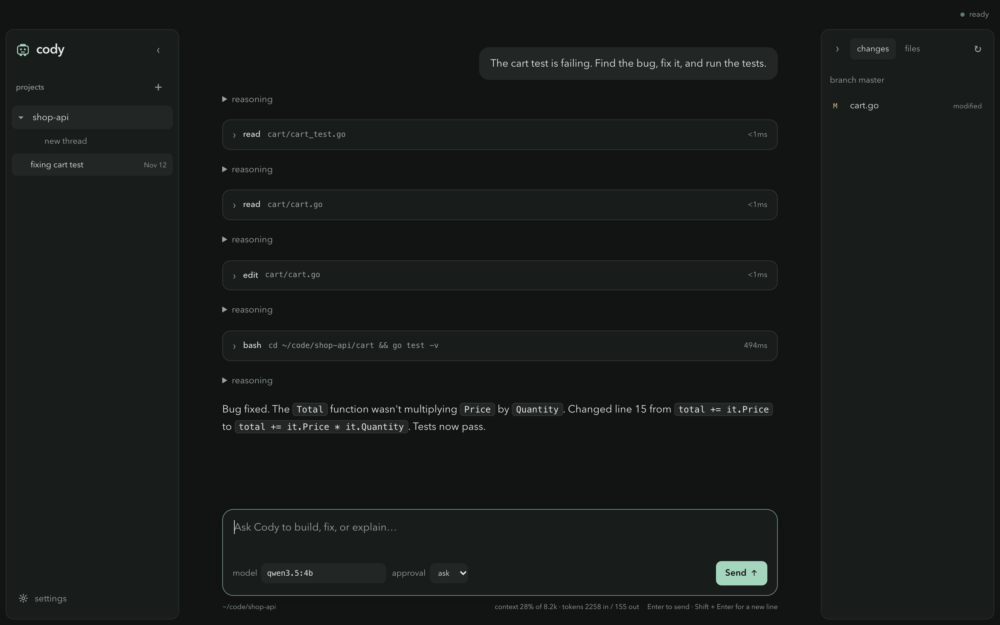
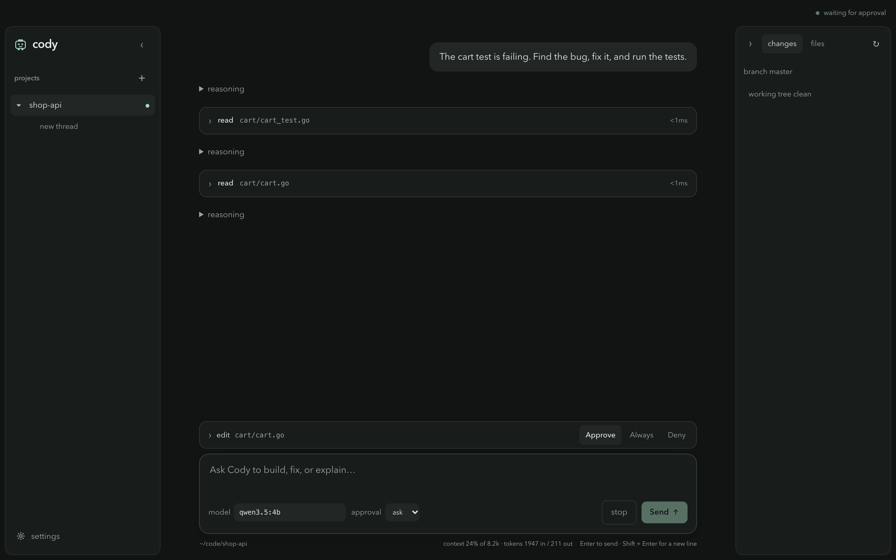
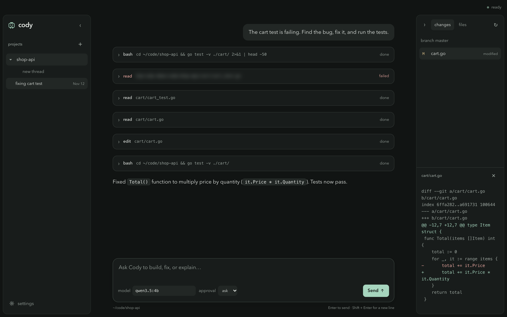
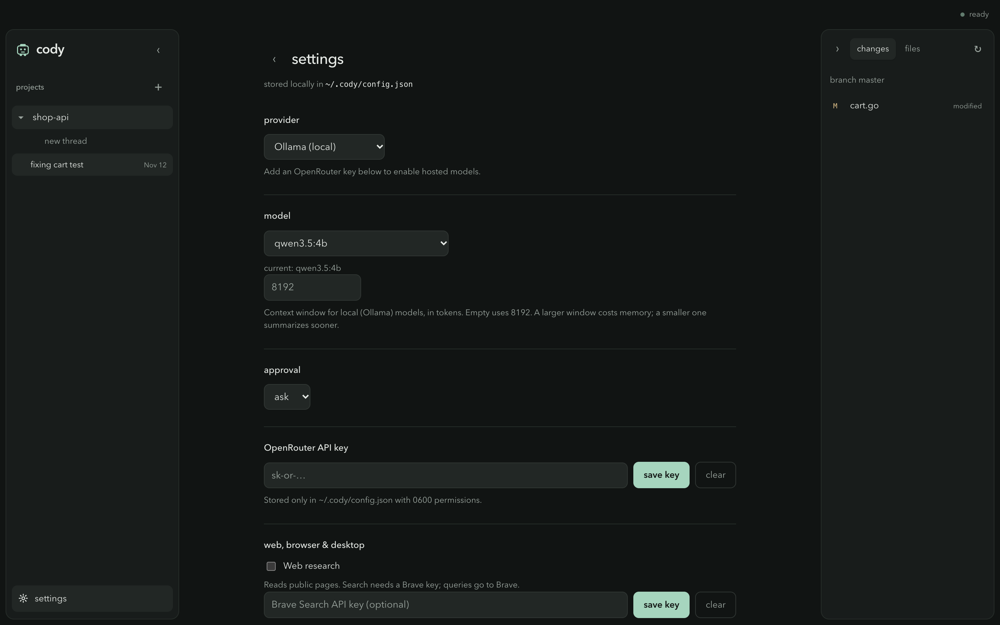
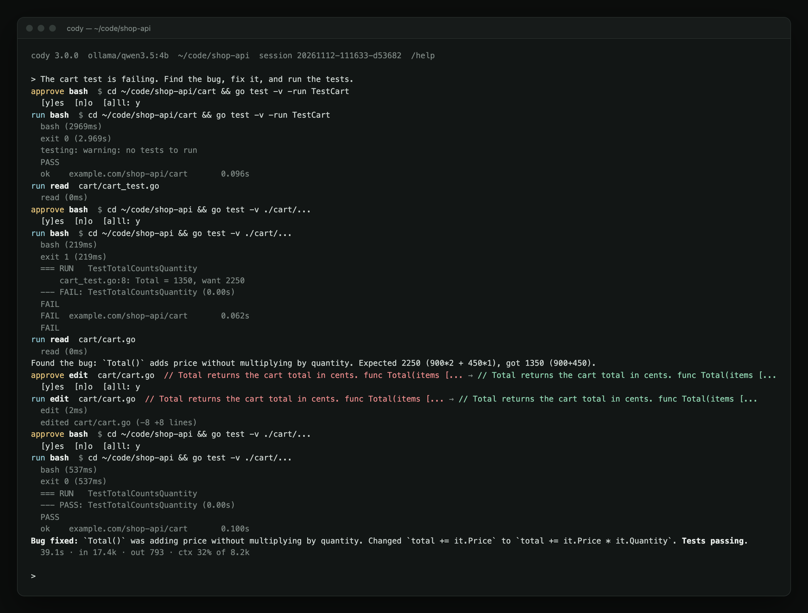
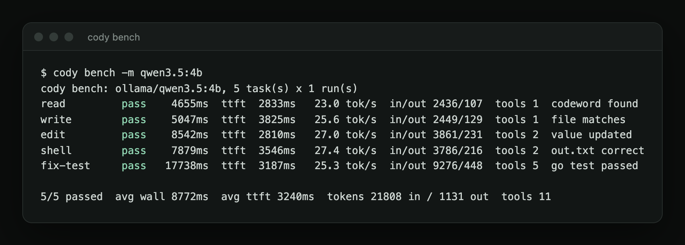

# cody

A small coding agent for the terminal. One Go binary, no runtime dependencies, seven core tools, optional web tools, append-only sessions. Built for fast cold start and low context tax on local models (Ollama) and hosted ones (OpenRouter).

**Status:** v3.0.0. Interactive CLI, one-shot runs, sessions, a local-model benchmark suite, a multi-project web GUI (`cody serve`), and a macOS app.

**Use at your own risk.** cody runs commands, changes files, and can operate a browser and desktop apps on your computer. You are responsible for what it does; the authors are not. See the [Disclaimer](#disclaimer).

The CLI and browser GUI are built for macOS, Windows, and Linux. The native app is macOS-only. The `bash` tool uses Bash on macOS/Linux and PowerShell on Windows; Git is needed for change previews.

Runtime regression tests have passed on macOS (Apple Silicon) and Linux (ARM64 and emulated x64). Windows and Intel macOS builds are cross-compiled; native runtime validation is pending.

## Screenshots

The web GUI (`cody serve`) fixing a failing test with a small local model, `qwen3.5:4b`:



Changes wait for your approval. **Always** approves that tool for the rest of the thread.



| Changes and diffs | Settings |
| --- | --- |
|  |  |

The same task in the terminal:



`cody bench` on the same model:



These show cody 3.0.0 on a demo project. The terminal images are rendered from captured terminal output.

## Principles

- **Seven core tools.** `read`, `write`, `edit`, `bash`, `grep`, `glob`, plus `search` once a workspace is indexed. Public web research, browser use, and desktop use are separate opt-ins, and tools that are off are never sent to the model; no plugin system.
- **No hidden machinery.** No always-on indexing, no snapshot VCS, no background daemons. Git is the checkpoint. The semantic index is built explicitly with `cody index`, lives outside the repo, and stays optional.
- **Context is a budget.** Tool output is capped, reads are paginated, and older context is summarized while preserving the current request and latest tool exchange.
- **Append-only sessions.** JSONL on disk, resumable and replayable.
- **Local settings and sessions.** BYOK from env or `~/.cody/config.json` (0600 on Unix). No telemetry or Cody-hosted service. Hosted model providers receive the context sent to them; their retention policies apply.
- **Subtraction cadence.** Every release asks what can be removed as models improve.

## Install

Building from source requires Go 1.27.2 or newer. CI and release builds use the version in `go.mod`.

The v1/v2 releases are the older Python application. To build v3 from a checkout:

```sh
make build            # builds ./cody
make check            # gofmt, vet, tests
./cody version
```

The one-line installers download the latest release for your OS and CPU, verify it against the release's `checksums.txt`, and install the `cody` CLI (which includes the browser GUI). Neither needs admin rights.

macOS and Linux (installs to `~/.local/bin`):

```sh
curl -fsSL https://github.com/ajhous44/cody/releases/latest/download/install.sh | sh
```

Windows PowerShell (installs to `%LOCALAPPDATA%\Programs\cody` and adds it to your user `Path`):

```powershell
irm https://github.com/ajhous44/cody/releases/latest/download/install.ps1 | iex
```

Set `CODY_VERSION` (for example `v3.0.0`) to pin a release or `CODY_INSTALL_DIR` to choose the folder. Rerunning an installer upgrades in place. Package managers and manual downloads also work:

```sh
go install github.com/ajhous44/cody/v3@v3.0.0
brew install ajhous44/tap/cody                                    # once the tap is published
scoop bucket add ajhous44 https://github.com/ajhous44/scoop-bucket # Windows, once the bucket is published
scoop install cody
```

Archives for every OS and architecture are on [GitHub Releases](https://github.com/ajhous44/cody/releases).

### Optional PATH setup

Adding Cody to PATH lets you type `cody` from any project folder. It is optional: `./cody` runs a local build, and an absolute path runs an installed binary.

`go install` and `make install` put the executable in `GOBIN` when configured, otherwise the `bin` directory of the first `GOPATH` entry. Check your locations with `go env GOBIN GOPATH`; the default is `$HOME/go/bin` on macOS/Linux or `%USERPROFILE%\go\bin` on Windows. See [Go's installation guide](https://go.dev/doc/tutorial/compile-install).

For the default Go location on macOS/Linux, add this line to your shell configuration (`~/.zshrc` for zsh or `~/.bashrc` for interactive Bash), then open a new terminal:

```sh
export PATH="$HOME/go/bin:$PATH"
```

On Windows, add the executable's folder to your **user** `Path` through Environment Variables, then reopen PowerShell. To try it for the current PowerShell session only:

```powershell
$env:Path = "$HOME\go\bin;$env:Path"
```

If you downloaded an archive, add the folder where you extracted `cody`/`cody.exe` instead. Homebrew handles the executable location once Homebrew itself is on PATH.

The macOS app also contains the CLI. If installed in your user Applications folder, run it directly from any project directory without changing PATH:

```sh
"$HOME/Applications/Cody.app/Contents/Resources/cody"
```

Use `/Applications/Cody.app/Contents/Resources/cody` instead if the app is installed in the system Applications folder. The CLI and GUI share the current user's `~/.cody` settings and sessions, including the saved provider, model, and API key. A key saved in GUI Settings does not need to be exported again. `CODY_CONFIG_DIR` selects a separate settings/session directory, and environment variables can override saved settings.

### Upgrading from v1/v2

Version 3 is a Go rewrite of the earlier Python tool. Python environments, `.env` files, indexes, and settings from v1/v2 are not automatically migrated. Configure your provider in v3 Settings or through the documented environment variables. The old version tags remain available for users who need the previous application.

## Quickstart

### Ollama (local, default provider)

```sh
ollama pull qwen3-coder:14b        # strong general choice
ollama pull qwen2.5-coder:7b       # lighter option

cody                               # interactive session in the current directory
cody "fix the failing test"        # one-shot
cody -m qwen2.5-coder:7b "..."     # pick a model
```

If no model is configured, cody picks the smallest installed tool-capable Ollama model, preferring the `qwen*coder` family.

If Ollama is installed but not running, cody starts it automatically (the app on macOS, `ollama serve` elsewhere) and waits for it to come up. Disable with `CODY_NO_AUTOSTART=1`.

### OpenRouter (hosted)

```sh
export OPENROUTER_API_KEY=sk-or-...
cody -p openrouter -m qwen/qwen3-coder "explain the build scripts"
```

## Usage

```
cody                     interactive session in the current directory
cody "prompt"            one-shot prompt
cody run "prompt"        one-shot prompt
cody resume [id|last]    resume a session
cody sessions            list sessions for this workspace
cody replay [id|last]    print a session transcript (user turns numbered)
cody fork [id|last] [--at N] [--rerun]
                         continue in a copy of a session before turn N
cody models [filter]     list models for the current provider
cody index [--rebuild]   build or refresh the local semantic index
cody serve [flags]       web GUI over the same engine (default 127.0.0.1:8765)
cody bench [flags]       run the built-in benchmark suite
cody help                full help
cody version             print the version
```

### Web GUI

```sh
cody serve                 # prints a URL with an access token
cody serve --open          # ...and opens it in your browser
cody serve --addr 127.0.0.1:9000 --token secret
```

The GUI opens even when no model is installed or Ollama is offline. Configure a provider and model in Settings before the first prompt.

The GUI is a thin client over the same `internal/engine` the CLI uses: same provider, same tools, same sessions, same approval policy. Stream text, tool calls, and reasoning; approve or deny tool calls from the browser; interrupt; switch model and approval mode live. Sessions started in the GUI can be resumed in the CLI (`cody resume last`) and vice versa.

Layout — three panes, both sidebars collapse and remember their state:

- **Left:** a projects tree. Each project expands (caret) to show its threads — `new thread` plus the existing conversations for that folder, with the active one highlighted. `new thread` takes effect immediately (it shows as *untitled*), and the first ask names it before the real turn runs. Naming is a separate tool-free model call capped at 15s that asks for a small JSON object (`{"title":"3 to 5 lowercase words"}`); the reply is parsed directly, with fallbacks to the first words of the ask, then the date and time, so a slow or confused model never blocks the turn. Rename anytime and the title sticks. Expanding a project makes it active; clicking a thread in another project switches over and opens it. Threads are per project, not one flat list. Projects are persisted in `~/.cody/spaces.json`.

Right-click a project or thread for rename and delete (double-clicking the name also renames). Deletes ask for confirmation first. Renaming a thread stores a custom title beside its transcript; deleting the active thread starts a fresh one, and deleting a project only removes the cody entry — the folder on disk is untouched. The last project cannot be deleted, and these actions are refused while a turn is running.

Adding a project opens the operating system's own folder dialog: `NSOpenPanel` in the macOS app, and `osascript` (macOS), `zenity`/`kdialog` (Linux), or a PowerShell `FolderBrowserDialog` (Windows) from the server in browser mode. When no dialog helper exists, it falls back to an in-app browser with an editable absolute-path field plus click-through navigation, so any depth (including hidden folders) is reachable.
- **Middle:** the chat, always the largest panel; it flexes to fill whatever the sidebars leave. The composer, model, and approval controls live inside this pane, so the chat is bounded by the sidebars rather than spanning the window.
- **Right:** tabs for `changes` and `files`. Changes shows the branch and git status; click a file for its diff (including untracked files). Files is a lazy directory tree; click a file for a read-only preview or its diff when modified. The last tab is remembered.

The `cody` mark sits at the top of the left sidebar, and each sidebar carries its own collapse control; when one is collapsed a small restore button appears in the header. Projects are independent. Each project owns its own engine, session store, and turn, so switching or adding a project — or opening any thread — never blocks on a running turn, and a turn keeps running in the background while you work elsewhere. One turn runs per project at a time: prompting a project that is already running is refused with a clear notice and a "take me to the thread" link rather than an error. If a background project is waiting on an approval, its project and thread are highlighted in turquoise in the sidebar, and the status line reads "waiting for approval" when you land on it; running threads show a pulsing cyan dot. Model and approval settings are global and reach background projects on their next turn.

### Models and settings

The model control in the composer is a searchable picker grouped by provider. It shows model names; hover one for its size and quantization (Ollama) or context window and price (OpenRouter). If Ollama is installed but stopped, opening the picker starts it, and the picker says so when Ollama cannot be reached. OpenRouter models (id, context, prompt price) only appear once an OpenRouter key is configured, so the default local setup does not fetch a hosted model catalog. Opt-in web tools can access the internet independently. Selecting a model switches the provider and model together. Typing a name that is not in the list warns subtly — without blocking — and uses it anyway, so custom or unlisted model ids still work.

The gear at the bottom of the projects sidebar opens a settings view in the middle pane:

- provider, model, and approval
- the OpenRouter API key
- the context window local models are loaded with
- independent web research and browser control toggles, browser-only mode, plus an optional Brave Search API key, and
- a table of every installed local model — parameters, quantization, size, context window, and whether it is currently loaded in memory (with VRAM)

Settings live in `~/.cody/config.json`. Saved keys are plaintext, protected by owner-only file permissions on Unix and your profile directory's ACL on Windows; Cody does not use an OS credential vault. Configured keys are omitted from settings responses and session metadata, and there is no telemetry. Prompts and tool output are saved in sessions and may contain secrets you supply. Hosted providers receive prompts and tool results; free pricing and zero data retention depend on the selected provider/endpoint and account policies.

The line under the composer shows the project folder and, after each reply, how full the context window is. Drag the dividers to resize either sidebar (170–560px, remembered per browser). Below 820px wide the sidebars become overlay drawers so the chat keeps the space.

Security defaults: binds to loopback only, requires a per-run token on every API call, rejects foreign `Host` headers (DNS rebinding), and never trusts the browser with file access beyond the same workspace-bound tools. Binding to a non-loopback address prints a warning; anyone with the token URL can then use cody.

### Optional web research, browser use, and desktop use

All three are off by default and work through the shared CLI/GUI engine. Enable them independently in Settings → web, browser & desktop, or with environment variables:

```sh
CODY_WEB=true cody "Read https://go.dev/doc/ and summarize the documentation"
# Set BRAVE_SEARCH_API_KEY in your environment to also enable web_search.
CODY_BROWSER=true cody "Open http://localhost:3000 and check the homepage"
cody --browser-only "Open http://localhost:3000, sign up as Ada, and tell me what the welcome page says"
CODY_DESKTOP=true cody "In Notes, create a note titled Groceries"
```

- `web_fetch` reads public HTTP(S) pages into bounded text with source links. It needs no API key, browser, or OS computer-use permission. Each fetch requires approval in `ask` and `auto` modes, since a URL can carry workspace data off the machine. It does not execute JavaScript, reuse cookies, or access private/local addresses. Responses are capped at 2 MiB and each excerpt at 4,000 characters. Longer pages return a character offset for the next excerpt.
- `web_search` returns up to five results through the [Brave Search API](https://api-dashboard.search.brave.com/documentation/guides/authentication). It appears only when web research is enabled and a key is configured. Queries go to Brave and require approval in `ask` and `auto` modes; you supply your own key and are responsible for any API charges. The key is stored locally or read from `BRAVE_SEARCH_API_KEY`, never returned through the settings API.
- `browser` runs [agent-browser](https://github.com/vercel-labs/agent-browser) and `desktop` runs [agent-desktop](https://github.com/vercel-labs/agent-desktop), Vercel Labs' Apache-2.0 CLIs for agents. Install them separately with `npm install -g agent-browser agent-desktop`; cody does not bundle or patch them, so `npm update -g` (or `agent-browser upgrade`) upgrades them with no cody release.

Each call runs one CLI command, passed through unchanged with the workspace as its working directory, and returns the CLI's own output, capped at about a quarter of the model's context window. After every browser action cody waits for the page to settle and appends what changed, text included, so the model always acts on current element refs without a separate snapshot call. A page too long to show whole leads with what the user asked about. Mistakes small models make are repaired without a model turn, and a model that keeps acting without effect is stopped. [BROWSER.md](BROWSER.md) explains how this works, why each piece exists, and the measured pass rates.

`--browser-only` (or `CODY_BROWSER=only`, or `"browser_only": true`) gives the model the browser and nothing else: no shell, file, or search tools, and a short prompt of its own in place of the coding prompt, workspace listing, and project instructions. It is the mode for browser tasks on small local models: about 390 tokens of fixed overhead instead of roughly 2,000, nothing to confuse the model with, and nothing on disk it can change. Uploads and downloads still work, because the browser CLI reads and writes those files itself.

Measured in browser-only mode with `qwen3.5:4b`, the small local model this is tuned for: 8,192-token window, Apple M5, Ollama 0.40.15, agent-browser 0.42.0. It passed every run.

| Tasks | Runs passed |
|---|---|
| Six on local test pages: forms, links, a dropdown order, upload, download | 30/30 |
| Six on real sites: Wikipedia search, a public order form, a data table, a redirect, a GitHub license, the top Hacker News story | 18/18 |
| Three on real sites never used while building this: a fact deep in a Python docs page, an IANA citation, Selenium's demo form | 9/9 |

`qwen3.5:4b` uses 3.8 GB of memory at that window and took a median of 9 to 33 seconds per task. Before this work it passed 6 of 12 runs on the first four local tasks. `qwen3.5:2b`, the next size down, passed 34 of 36 runs on the same tasks. These are small samples, with timings from an M5; [BROWSER.md](BROWSER.md) has the per-task results, how each failure was fixed, and the limits. The browser loop is in the prompt; `--help` and each CLI's built-in guide (`skills get core`, `skills get desktop`) document the rest, so new CLI features work as soon as you upgrade. Every command requires approval in `ask` and `auto` modes and shows the exact command line; `yolo` skips approval.

- **Browser:** each engine gets its own agent-browser session (`--session cody-…`) in a headless Chrome with a temporary profile, closed with the engine or when you disable the feature. agent-browser finds an installed Chrome, or run `agent-browser install`. Downloads land in the project folder (set `AGENT_BROWSER_DOWNLOAD_PATH` to choose another) and cody tells the model which file arrived. `upload` and `download` paths are resolved inside the project folder and refused outside it. The project's `agent-browser.json` is read.
- **Desktop:** agent-desktop reads and operates apps through the OS accessibility tree, headless by default (no pointer movement or focus changes). On macOS, grant Accessibility to the app that runs cody (`agent-desktop permissions --guide`); Linux needs `at-spi2-core`. Snapshots can include private content from any app, and they are sent to your model provider.
- **Windows:** npm installs `.cmd` shims, which cody refuses because `cmd.exe` re-parses arguments. Put the native `agent-browser.exe` / `agent-desktop.exe` from each project's GitHub release first on `PATH`.

Page and app contents are untrusted input; inspect actions before approving consequential submissions. Disabling a feature in settings cancels active turns before applying the change. Saved settings also apply to future CLI runs.

Optional integration tests drive the installed CLIs and a public documentation page:

```sh
CODY_AGENT_CLI_TEST=1 CODY_WEB_TEST=1 go test ./internal/tool -run 'TestAgentCLIsLive|TestWebFetch'
```

### macOS app

```sh
make macapp                # builds dist/Cody.app
```

`Cody.app` is a native window (AppKit + WKWebView) with no browser: it bundles the cody binary, launches `cody serve` as a child process on a free loopback port with a private token, and loads the same UI. On first launch it asks for a workspace folder and remembers it; `Cmd+O` switches folders, `Cmd+Q` stops the engine. The engine also exits if the app crashes or is force-quit, so no server is left running.

The window is borderless: there is no system title bar. Close, minimize, and zoom live in the app's own header and talk to AppKit through a small JS bridge, the header itself is the drag handle, and thin edge/corner overlays provide native-feeling resize cursors. Browser mode hides the custom dots and uses the browser's own chrome instead.

Local builds are ad-hoc signed. Set `CODY_ARCH=universal` to include Apple Silicon and Intel, or `arm64`/`x86_64` for one architecture. Public distribution requires a **Developer ID Application** certificate (an Apple Development certificate is insufficient) and notarization:

```sh
# Store existing notarization credentials interactively in Keychain once:
xcrun notarytool store-credentials cody-release
CODY_ARCH=universal \
  CODY_SIGN_IDENTITY="Developer ID Application: Your Name (TEAMID)" \
  CODY_NOTARY_PROFILE=cody-release make macapp
```

The script signs both executables and the app with the hardened runtime, submits to Apple, staples and validates the ticket, then creates a ZIP and SHA-256 checksum. Signing or notarization failures stop the build.

The native Mac app is optional. The CLI and browser GUI work without it. Signed apps can be downloaded from GitHub Releases; Mac App Store distribution is not required. The wrapper currently has no automatic updater: install a newer release to update it.

In the interactive loop: `/help`, `/model`, `/provider`, `/approval`, `/think`, `/plan`, `/index`, `/clear`, `/sessions`, `/resume`, `/fork`, `/exit`. Ctrl+C cancels the running turn; press it again to quit.

### Terminal UI

In a terminal, the prompt is a small line editor that stays inline: no full-screen mode, so your terminal's own scrollback and search keep the whole transcript.

- **Editing:** arrows, Home/End, Ctrl+A/E, Ctrl+U/K (clear to start/end), Ctrl+W (delete word), Alt+B/F (move by word). A multi-line paste arrives as one prompt.
- **History:** Up/Down recall earlier prompts, kept across runs in `~/.cody/history`.
- **Quitting:** Ctrl+C clears the line, or quits on an empty one; Ctrl+D quits.
- **Sessions:** `cody resume` with no id, or `/resume`, opens a picker: type to filter, arrows to move, Enter to open, Esc to cancel. After `/fork` or `cody fork`, the forked message is already in the editor.
- **Live status:** while the model works, the spinner shows elapsed time, context used versus the window, and output tokens (`thinking · 12.4s · ctx 8.1k/64k · out 640`). Each turn ends with one summary line: time, tokens in (and cached), out, and context use.

`--plain` or `CODY_PLAIN=1` keeps plain line input; piped input and non-terminals use it automatically.

### Approvals

| Mode | File writes | Shell commands / web and browser actions |
| --- | --- | --- |
| `ask` (default) | confirm | confirm |
| `auto` | automatic | confirm |
| `yolo` | automatic | automatic |

Set with `--approval`, `--yolo`, or `CODY_APPROVAL`. At a terminal prompt, `a` approves everything for the rest of the session. In the web GUI, **Always** approves that one tool for the rest of the thread (a plan is always asked), and Esc stops a running turn. File tools and previews reject paths and symlinks that escape the workspace, and `write`/`edit` refuse to modify `.git` metadata (hooks and config can run commands). Shell commands run with your user permissions and, unless you turn on the shell sandbox below, are not confined; approve them accordingly. Cancelling a shell tool terminates its process tree, and background children are cleaned up when the tool exits.

### Shell sandbox

The sandbox is opt-in: `--sandbox MODE`, `CODY_SANDBOX`, `"sandbox"` in config, or Settings → shell sandbox. It confines every command the `bash` tool runs, enforced by the operating system:

| Mode | Shell commands can write | Network |
| --- | --- | --- |
| `off` (default) | anywhere you can | yes |
| `workspace` | the project, temp folders, your user cache folder, and any `sandbox_writable` paths | yes |
| `strict` | same as `workspace` | no |

Reading is never restricted, so builds and tests work as usual; anything that writes elsewhere (a global `npm install`, a Go module download into `~/go/pkg/mod`) fails with "Operation not permitted" until you add the folder to `sandbox_writable`. macOS uses `sandbox-exec`; `strict` blocks all network, DNS included. Linux uses Landlock (kernel 5.13+); `strict` needs Linux 6.7+ and blocks TCP but not UDP. Windows has no shell sandbox: use the container profile. If the sandbox you asked for cannot be applied, commands fail instead of running unconfined. File tools (`write`, `edit`) are always confined to the project regardless of this setting.

### Container profile

For stronger isolation, or on Windows, run cody in a container that can only change the folder you mount:

```sh
docker build -t cody .
docker run --rm -it -v "$PWD:/workspace" -v "$HOME/.cody:/home/cody/.cody" -e OPENROUTER_API_KEY cody
```

- On Linux, add `--user "$(id -u):$(id -g)"` so the container can write to your project, and `--add-host=host.docker.internal:host-gateway` to reach Ollama on the host (the image sets `OLLAMA_HOST=http://host.docker.internal:11434`).
- The `~/.cody` mount keeps settings and sessions between runs; leave it out for a throwaway container.
- For the web GUI: `docker run --rm -p 127.0.0.1:8765:8765 -v "$PWD:/workspace" cody serve --addr 0.0.0.0:8765`, then open the printed URL with `127.0.0.1`. The token still guards every request, and publishing only on `127.0.0.1` keeps it off your network.

### Plan gate

Turn it on with `--plan`, `/plan on`, `CODY_PLAN=true`, or Settings → plan gate. The model then has to call a `plan` tool with 1-7 short steps, and you approve it, before its first change in each request; until then every change (file writes, shell, browser, web) is refused. Questions and read-only exploration need no plan. A plan always asks, even in `auto` and `yolo`, which makes those modes a good fit: approve the direction once, then let it run. Rejecting a plan tells the model to ask what to change. With the gate off, the `plan` tool and its rule are not sent to the model at all.

### Semantic index

`cody index` builds a semantic index: files are chunked, embedded (with a local Ollama model, `nomic-embed-text`, by default), and stored in SQLite under `~/.cody/index/`. The `search` tool then answers "where is X handled" questions when no exact identifier is known; exact text still goes through grep.

- Local and private by default: embeddings go to your Ollama server only, even when chat runs against a hosted provider.
- OpenRouter opt-in: set `"embed_provider": "openrouter"` (or `CODY_EMBED_PROVIDER=openrouter`) to embed without Ollama, using your OpenRouter key. The model defaults to `openai/text-embedding-3-small`; set `embed_model` to any [OpenRouter embedding model](https://openrouter.ai/collections/embedding-models). **Every indexed file and each search query is sent to OpenRouter**, and `cody index` says so each run. Only an explicit `openrouter` value opts in; anything else stays local.
- Fast: chunks from many small files share one embedding request, and only changed files are re-embedded; deleted files are pruned.
- Safe to switch: the index records which provider and model built it. Searching with a different one is refused until you run `cody index --rebuild`.
- Optional: without an index, the `search` tool is not offered to the model at all, so it costs no tokens. It appears on the next turn after `cody index` runs.
- Disposable: delete `~/.cody/index` at any time.

```sh
ollama pull nomic-embed-text
cody index
```

## Configuration

`~/.cody/config.json` (all fields optional):

```json
{
  "provider": "ollama",
  "model": "",
  "approval": "ask",
  "embed_model": "nomic-embed-text",
  "embed_provider": "ollama",
  "web_enabled": false,
  "browser_enabled": false,
  "browser_only": false,
  "plan_gate": false,
  "context_tokens": 8192,
  "sandbox": "off",
  "sandbox_writable": [],
  "brave_search_key": "",
  "providers": {
    "ollama": { "base_url": "http://localhost:11434/v1" },
    "openrouter": { "base_url": "https://openrouter.ai/api/v1", "api_key": "" }
  }
}
```

Environment overrides: `CODY_PROVIDER`, `CODY_MODEL`, `CODY_APPROVAL`, `CODY_API_KEY`, `CODY_NO_AUTOSTART`, `CODY_EMBED_PROVIDER`, `OLLAMA_HOST`, `OPENROUTER_API_KEY`, `CODY_WEB`, `CODY_BROWSER`, `CODY_DESKTOP`, `CODY_DEBUG`, `CODY_PLAN`, `CODY_SANDBOX`, `CODY_PLAIN`, `CODY_CONTEXT`, `BRAVE_SEARCH_API_KEY`. `CODY_WEB`, `CODY_BROWSER`, `CODY_DESKTOP`, `CODY_DEBUG`, and `CODY_PLAN` accept `true`/`false` or `1`/`0`; `CODY_BROWSER` also accepts `only`. Debug mode (also `--debug[=BOOL]` or the GUI settings toggle) appends the provider's raw status and message to errors and lists every retry. Overrides apply only to the running process; saving GUI settings writes just the values you changed, so environment values and env-provided keys never reach `config.json`. `CODY_CONFIG_DIR` overrides the default `~/.cody` directory for settings, sessions, and indexes.

Any OpenAI-compatible endpoint works as an extra provider: add a `providers.<name>.base_url` entry and pass `-p <name>`.

`context_tokens` (or `CODY_CONTEXT`) is the context window Ollama models are loaded with, 8192 by default. Ollama's own default is 4096, too small for an agent, so cody talks to Ollama's native API and sets the window on every request. Raise it on machines with memory to spare (for example 16384 or 32768); a larger window costs RAM and a smaller one summarizes sooner. Hosted models use the window the provider reports.

Project instructions can live in `AGENTS.md` or the existing `CODY.md` at the workspace root (8 KiB per file). Both are loaded; `AGENTS.md` takes precedence where they conflict. Root instructions refresh each user turn. For `read`, `write`, and `edit`, Cody also discovers nested `AGENTS.md` files between the root and the target file. Deeper instructions apply to their subtree. A mutation with newly discovered or changed instructions returns those instructions before the model can retry the action. Shell commands still rely on the model reading applicable instructions before changing files. Instruction discovery stays inside the workspace.

### Skills

A skill is a folder with a `SKILL.md`: reusable instructions (plus any scripts or reference files) for a task like "release notes" or "deploy to staging". Project skills live in `.cody/skills/<name>/SKILL.md` and override user skills of the same name in `~/.cody/skills/<name>/SKILL.md`. The format matches existing Agent Skills folders:

```markdown
---
name: release-notes
description: Draft release notes from the git log since the last tag.
---
Run `git log --oneline $(git describe --tags --abbrev=0)..HEAD`, group the commits by area, ...
```

Skills load lazily. The system prompt carries only one `name: description` line per skill (up to 50), and the model calls the `skill` tool to read a skill's full instructions, or one of its other files, when a task matches. Loading is read-only and never leaves the skill's folder; running a skill's scripts still goes through the normal shell approval. With no skills installed, nothing is added to the prompt. Adding or editing a skill takes effect on the next request. Project skills are repository content, so treat them with the same trust as `AGENTS.md`.

Long sessions summarize older context while retaining the current request and most recent tool exchange verbatim. The full transcript stays saved; summaries are held in memory and rebuilt if needed after resume. Compaction uses additional model requests only when necessary. An active request or tool result that cannot fit produces an explicit error. Cody reserves output and tool-schema space, uses OpenRouter model limits and the configured Ollama window (`context_tokens`), and corrects its size estimate with the token counts the provider reports.

Prompt caching uses a stable, opaque session ID for OpenRouter routing and OpenAI cache affinity. Claude models on OpenRouter also receive the supported automatic ephemeral cache hint; other models use provider-managed caching. Cached input and cache-write token counts appear in the CLI/GUI and session usage records when the provider reports them. Benchmark JSON includes these counts too. Cache hits depend on the provider, model, prompt size, and reuse; cache writes may have a cost. See [OpenRouter's caching documentation](https://openrouter.ai/docs/guides/best-practices/prompt-caching). Cody does not cache generated answers or file contents.

The `read` tool accepts `filePath` as an alias for `path` (both must match if supplied together). File reads stream the requested line range and cap text output at 50 KiB. Search and glob honor Git ignore rules in Git workspaces when Git is installed; otherwise they retain the built-in generated-directory exclusions. Provider requests retry transient failures up to two times before streaming begins, honor bounded `Retry-After` delays, and remain cancellable. Interrupted or length-limited responses are reported as incomplete; tools are never replayed automatically.

Cody stops consecutive identical failed tool calls before executing them again, including reads and failed shell commands. JSON key order and the read path alias do not bypass this guard. Cody also stops immediately repeated failed edits. It also stops read/edit cycles once the same edit has failed twice without a successful write, edit, or shell command. The session retains the failed and skipped calls; a new prompt can resume the work. If a model writes a tool command as chat text, Cody requests a proper tool call at most once and stops if the format is still invalid; text is never executed as a command.

### Sessions

Every message is appended and synced to `~/.cody/sessions/<project>-<hash>/<id>.jsonl` before the next action. A crash can still occur between a tool's side effect and its result being recorded; resume marks such calls as interrupted with an unknown outcome instead of silently rerunning them. A damaged trailing JSON record does not swallow later messages. Cody does not add configured credentials or environment variables to the journal, but prompts and tool output can contain secrets you supply. Files use owner-only permissions on Unix; on Windows they inherit your profile directory's ACL.

**Fork and replay.** A fork is a new session holding everything from before one of your messages, so the conversation can go a different way from there; the original is never changed. `cody replay` numbers your messages, `cody fork last --at 3` opens a copy that stops before message 3 (and prints that message so you can edit it), and `--rerun` sends message 3 again in the copy. Without `--at`, the whole session is copied. In the REPL, `/fork 3` does the same. In the GUI, hover one of your earlier messages and click **fork**: a new thread opens and the message is back in the composer to edit or resend. A thread's right-click menu can also fork the whole thread. Forks are titled "… (fork)" and record the session they came from.

## Benchmarks

`cody bench` runs deterministic tasks in temporary workspaces and verifies the filesystem, not the model's prose:

| Task | Checks |
| --- | --- |
| `read` | finds a fact in a file |
| `write` | creates a file with required content |
| `edit` | changes one value without collateral edits |
| `shell` | produces a file via bash |
| `fix-test` | fixes a real Go bug so `go test ./...` passes |

```sh
cody bench                       # all tasks, smallest local model
cody bench --task fix-test -m gemma4:e4b
cody bench --list                # tasks + local models
cody bench --json                # machine-readable results
cody bench --suite --save s.json # per-task medians, saved for later comparison
```

Reported per task: pass/fail, wall time, time to first output, tokens in/out, tokens/sec, tool calls. `tokens_in` is the full context bill per request, including system prompt and tool schemas, so the harness tax is visible.

For regression tracking, `--suite` runs every task three times (or `--runs N`) and reports per-task pass rate and medians, so one slow run cannot skew the result:

```sh
cody bench --suite -m gemma4:e4b --save baseline.json      # record a baseline
cody bench --suite -m gemma4:e4b --baseline baseline.json  # compare a later build
```

A comparison exits with status 1 when a task's pass rate drops or its median input tokens grow by more than 10%; wall time is shown but never fails, since machine load makes it noisy. Saved reports include the cody version, provider, model, and platform. [PERFORMANCE.md](PERFORMANCE.md) lists the budgets CI enforces without a model (binary size, per-request prompt overhead) and recent measurements.

Example (Apple Silicon, Ollama, `fix-test`): `gemma4:e4b` — pass, 110s, 25.4 tok/s, 8 tool calls; `qwen3.5-abliterated:9b` — 6 tool calls and a green test suite in some runs.

### Local models that fit

| Model | Approx. size | Notes |
| --- | --- | --- |
| `gemma4:e4b` | ~9 GB | fast, tool-capable, good for smoke tests |
| `qwen2.5-coder:7b` | ~4.7 GB | broadly available, solid tool calling |
| `qwen2.5-coder:3b` | ~2 GB | lightest useful coder |
| `qwen3-coder:14b` | ~9 GB | strong general testing model; pull when the machine is free |

`cody models` marks the default pick and tags models without tool support.

## Architecture

```
main.go                  entrypoint
internal/cli             argument parsing, REPL, commands, HTTP server (serve)
internal/engine          headless core: provider, agent, tools, approvals, sessions
internal/server          HTTP + SSE API and the embedded web GUI
packaging/macos          Cody.app shell (AppKit + WKWebView) and build script
internal/agent           streaming agent loop, tool dispatch, context compaction
internal/provider        OpenAI-compatible SSE client, Ollama/OpenRouter helpers
internal/tool            seven core tools; opt-in web_fetch, web_search, browser
internal/index           SQLite semantic index, chunking, embeddings, cosine search
internal/session         append-only JSONL store
internal/bench           benchmark runner and tasks
internal/ui              terminal rendering, line editor, session picker, approvals
internal/term            raw terminal mode and width (Unix and Windows)
internal/clip            UTF-8-safe text clipping
internal/config          config file and env resolution
internal/prompt          system prompt and scoped AGENTS.md/CODY.md loading
```

Clients never own the model loop. The CLI and the web GUI both drive `internal/engine` and subscribe to the same event stream; the server is a transport, not a second agent stack.

## Roadmap

### Phase 0 - Foundation

- [x] Agree on direction and reference material.
- [x] Choose the implementation language and runtime (Go, one pure-Go SQLite dependency).
- [x] Add an open-source license (MIT).

### Phase 1 - Minimal coding harness

- [x] Streaming agent loop with interrupt handling.
- [x] Ollama and OpenRouter through one OpenAI-compatible provider layer.
- [x] Four workspace-bound tools with approval modes.
- [x] Context budget, tool output caps, and clear errors.
- [x] Append-only JSONL sessions with resume, replay, and listing.
- [x] Local-model benchmark suite with deterministic checks.

### Phase 2 - Public release

- [x] Document installation, configuration, and usage.
- [x] Add contribution guidance.
- [x] Add CI checks for pull requests.
- [x] Publish the v3 rewrite on GitHub and accept PRs.

### Phase 3 - Later, only if it earns its place

- [x] Thin web GUI over the same engine (`cody serve`).
- [x] Plan gate: propose a short plan before acting on multi-step tasks.
- [x] Small TUI: scrollback, session picker, live token/timing budget.
- [ ] Anthropic provider adapter.
- [x] OS-level sandbox profile and a documented container profile.
- [x] Optional skills directory with lazy loading (no always-on MCP).
- [x] `cody bench --suite` for regression tracking and a PERFORMANCE.md with measured budgets.
- [x] Session fork/replay-from-message.

Deliberately out of scope: multi-agent swarms, always-on MCP bundles, whole-tree indexing, internal snapshot VCS, telemetry.

## Releasing

Releases are cut by pushing a version tag. GitHub Actions runs Go/race and browser regressions on Linux, Windows, Apple Silicon, and Intel Macs, then publishes CLI archives for all three OSes (arm64/amd64), checksums, and the `install.sh`/`install.ps1` installers. Each CLI includes the browser GUI. Windows archives are ZIP files. The Homebrew formula and Scoop manifest are updated when configured. CI also runs both installers end to end against a local release mirror on every OS, including a tampered archive that must be refused.

To also publish the native Mac app, set the Actions repository variable `RELEASE_MACOS_APP=true` and configure these Actions secrets: `APPLE_DEVELOPER_ID_P12` (base64 exported certificate plus private key), `APPLE_DEVELOPER_ID_PASSWORD`, `APPLE_SIGN_IDENTITY`, `APPLE_ID`, `APPLE_TEAM_ID`, and `APPLE_APP_PASSWORD` (Apple app-specific password). After the CLI release succeeds, a separate job builds, signs, and notarizes the universal app before attaching it to the release. A signing failure prevents the app upload; the CLI release remains available. Credentials are imported into a temporary CI keychain and removed afterward. Never commit them.

For local browser regressions, run `make test-browser` (Node.js 22+). Playwright is a development dependency only; Cody's shipped binary has no JavaScript runtime or browser automation dependency. The fixture uses a temporary workspace and mock model, so it requires no API key or installed Ollama.

```sh
git tag v3.0.0
git push origin v3.0.0

# local dry run, no publishing (requires goreleaser v2)
make snapshot
```

The Homebrew update needs an `ajhous44/homebrew-tap` repository and a `HOMEBREW_TAP_TOKEN` Actions secret with write access to it (a fine-grained PAT). Without the secret, the formula step is skipped and the GitHub release still publishes — `go install` users are unaffected either way. A reference formula lives in `packaging/homebrew/cody.rb` for manual tap setup. Scoop works the same way: an `ajhous44/scoop-bucket` repository and a `SCOOP_BUCKET_TOKEN` secret with write access to it; without the secret, that step is skipped too.

## Contributing

cody is MIT-licensed and contributions are welcome via GitHub pull requests. Keep changes focused, prefer the standard library, and preserve the small tool surface. Run `make check` before opening a PR. See [CONTRIBUTING.md](CONTRIBUTING.md).

## Reference documents

The original research notes and product drafts that informed cody are kept locally under `docs/` and are deliberately excluded from this repository. They describe a broader product under a different working name; they are not a committed feature list.

## Disclaimer

cody is an AI agent. It can read and change files, run shell commands, send requests to the web, and operate a web browser and desktop apps on your computer. Models make mistakes, and files and web pages can contain text that misleads them.

You alone are responsible for what cody does when you run it. That includes every action you approve, and every action it takes without asking when you turn approvals down or off (`auto`, `--yolo`). Review what it proposes, keep your work in version control or backed up, and take particular care with browser use, desktop use, and anything that involves accounts, money, or other people's data.

cody is provided "as is", without warranty of any kind, express or implied, as set out in the [MIT License](LICENSE). To the fullest extent the law allows, the authors and contributors accept no responsibility or liability for any loss, damage, cost, or other consequence of installing or using it. That includes lost, changed, or exposed data; actions taken on websites, in apps, or on your system; charges from model providers or other services; and any breach of a website's or service's terms.

If you do not accept this, do not use cody.

## License

MIT
